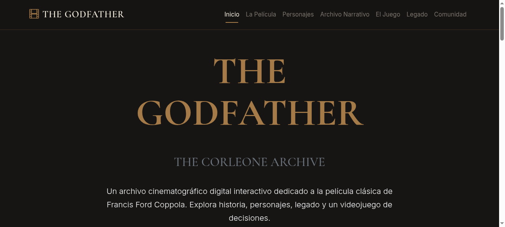

# 🎬 THE GODFATHER — THE CORLEONE ARCHIVE (V2.0)

<div align="center">


**Un archivo digital interactivo de *The Godfather* (1972)**

> La familia que controló el crimen, la belleza que lo definió. Explora, decide y descubre el legado Corleone.


</div>

---

## 📸 Panorama del proyecto

<div align="center">

| Hero | La Película | El Juego |
|------|-------------|-----------|
|  |  |  |

</div>

---

## ✨ Animación tipográfica & diseño

Este proyecto respeta la **identidad de *The Godfather* (1972)** en cada píxel:

- **Tipografía titular:** `Cormorant Garamond` / `Playfair Display` — elegancia neoclásica
- **Tipografía de texto:** `Inter` / `Source Sans Pro` — legibilidad
- **Paleta cinematográfica:** marfil `#F1EBDD`, tinta negra `#171513`, borgone `#4B121B`, dorado `#A47A48`
- **Efectos:** textura de grano microscópico, transiciones suaves, modales cinematográficos

> *"The power of the family is not in the sword, but in the blood."*

---

## ✨ Características

- 🎮 **El Consejo de la Familia** — 6 escenarios, 3 decisiones cada uno, 3 indicadores (Estrategia, Lealtad, Prudencia) y 5 finales
- 📜 **Archivo Narrativo** — línea del tiempo con documentos, fotos y testimonios
- 🎭 **Exploración de personajes** — 8 personajes clave interpretados por los actores originales
- 🎥 **Exploración narrativa** — usuario elije el camino de la historia
- 💬 **Foro de visitantes** — comunidad que comparte sus interpretaciones
- 📊 **Panel de estadísticas** — partidas jugadas, mejores scores, miembros logrados
- 📱 **Totalmente responsive** — desde móvil hasta pantalla grande

---

## 🛠 Tecnologia

<div align="center">

|  |  |  |  |
|---|---|---|---|
|  |  |  |  |

</div>

---

## 🎮 El Consejo de la Familia — Mecanica de juego

Cada escenario presenta una situación crítica de la saga. El jugador decide qué hacer y las tres métricas clave evolucionan según sus elecciones:

| Indicador | Descripción |
|-----------|-------------|
| 🔥 **Estrategia** (power) | Capacidad de maniobra política y expansión del poder |
| ❤️ **Lealtad** (loyalty) | Nuestra de los miembros de la familia y la comunidad |
| 👁️ **Prudencia** (reputation) | Imagen pública, impacto legal y reputación |

**5 finales posibles:**

| Final | Condición |
|-------|-----------|
| 🏛️ **El Legado** | Estrategia ≥ 60, Lealtad ≥ 60, Prudencia ≥ 60 |
| 📉 **El Caído** | Estrategia ≥ 60, sin equilibrio |
| 🛡️ **El Defensor** | Lealtad ≥ 60, sin alcance |
| 🕊️ **El Estigado** | Prudencia ≥ 60, sin poder |
| 💔 **La Familia Rotta** | Cualquier indicador < 40 |

---

## 📁 Arquitectura del proyecto

```
V2/
├── index.html                    # Entrada principal (Bootstrap 5.3, Vite)
├── package.json                  # Dependencias y scripts
├── tsconfig.json                 # TypeScript (strict)
├── vite.config.ts                # Vite 5.4.10 (chunks, base: '/')
├── README.md                     # Este archivo
├── docs/
│   ├── design/KIRO_VISUAL_REVIEW.md   # Revisión creativa Kiro
│   ├── game-design/GAME_DESIGN_DOCUMENT.md # Documento de juego
│   └── ...
├── public/
│   ├── assets/
│   │   ├── css/main.css          # Diseño editorial (dark/marble, gold)
│   │   └── images/               # Personajes y favicon
│   └── images/                   # Elementos estáticos
├── src/
│   ├── main.ts                   # Controlador de UI
│   └── game/                     # Motor puro (sin DOM)
│       ├── index.ts
│       ├── core.ts               # Logica: clamp, score, ending
│       ├── scenarios.ts          # 6 escenarios / 3 decisiones
│       ├── types.ts              # Interfaces canónicas
│       └── storage.ts            # Persistencia localStorage
├── shot-*.png                    # Capturas del prototipo
└── tests/
    └── game.test.ts              # 39 tests de lógica pura
```

---

## 🏗 Instalación

```bash
# 1. Clonar el repositorio
git clone https://github.com/jeronimoparra-ai/godfather-corleone-archive-v2.git
cd godfather-corleone-archive-v2

# 2. Instalar dependencias
npm install

# 3. Compilar
npm run build

# 4. Verificar (build + tests)
npm run build && npx vitest run
```

---

## ▶️ Ejecutar

```bash
# Con Vite (desarrollo)
npm run dev

# Servir dist (producción)
npm run preview
```

---

## 🚀 Publicar (Vercel / GitHub Pages)

### Vercel (recomendado)
```bash
# Instalar CLI
npm i -g vercel

# Autenticarse
vercel login

# Enlazar (primera vez)
vercel link

# Deploy
vercel deploy --prod
```

### GitHub Pages
1. Ir a **Settings → Pages → Deploy from a branch**
2. Seleccionar `main` branch y `/root` (o `/dist` según la configuración)
3. Guardar

### Torced al repositorio
```bash
git push origin main
```

---

## 📜 Licencia

Este proyecto es un trabajo académico del **SENA** (Servicio Nacional de Aprendizaje) para el **Evidence 21: "Desarrollo de aplicativo Bootstrap"**.

*Los personajes y elementos son propiedad de Paramount Pictures. Este proyecto es una adaptación educativa de *The Godfather* (1972) por Parreira, para fines educativos dentro del programa de Técnico en Programación de Software.*

---

<div align="center">

**Una obra del estudiante de SENA — Proyecto humanity 21.**

Made with 💙 + Bootstrap + Vite + TypeScript

</div>
